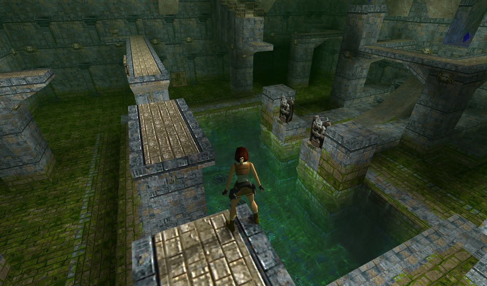
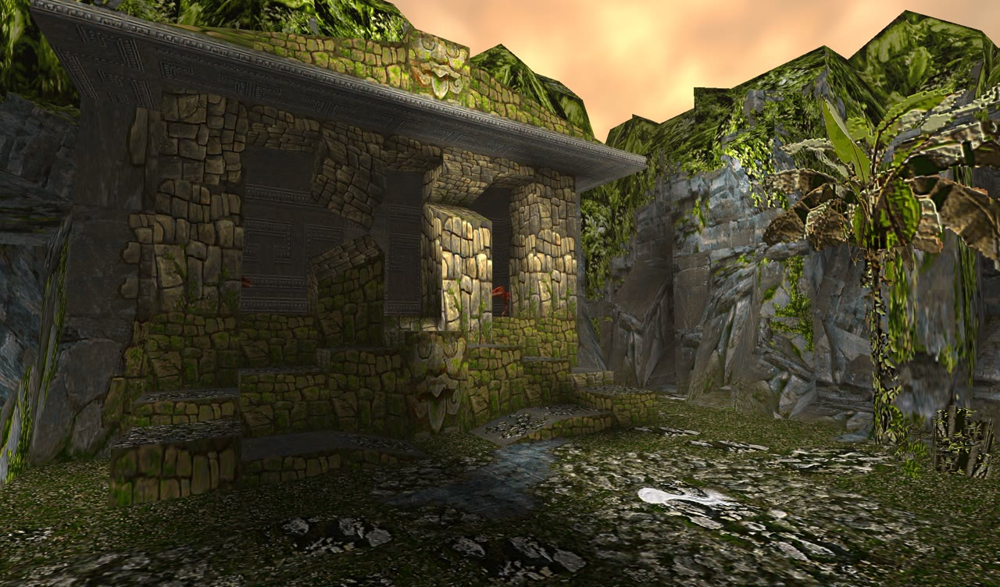
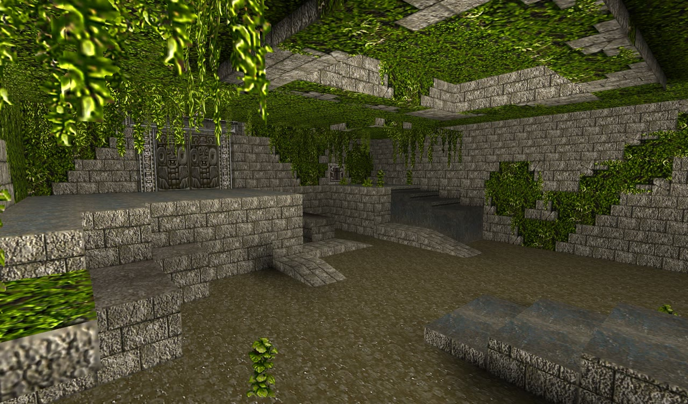
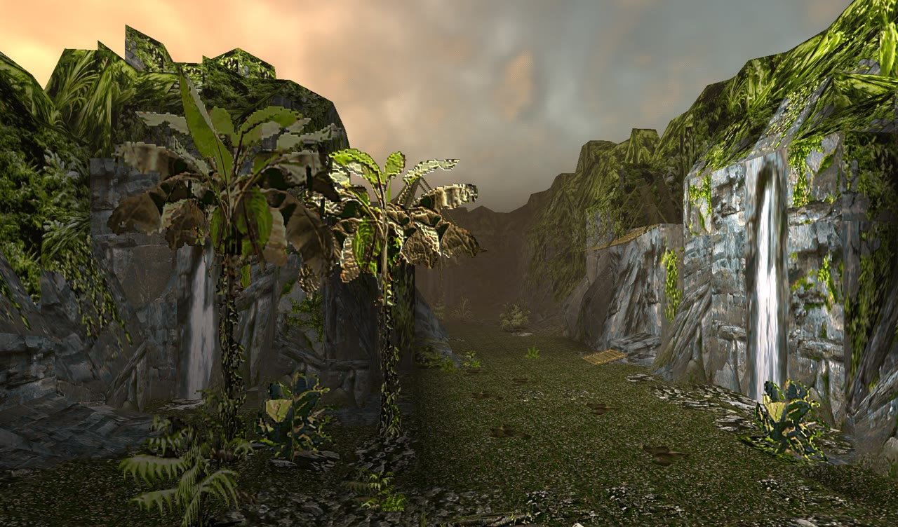
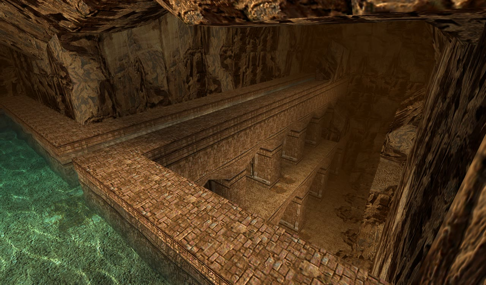
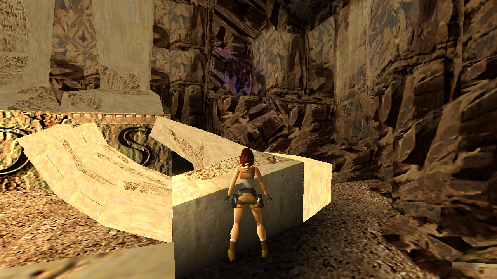
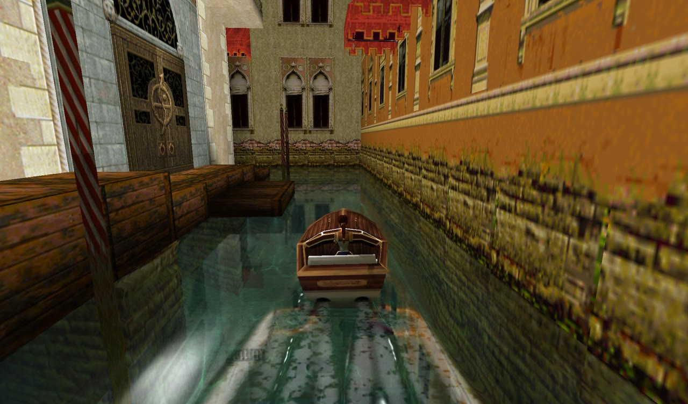
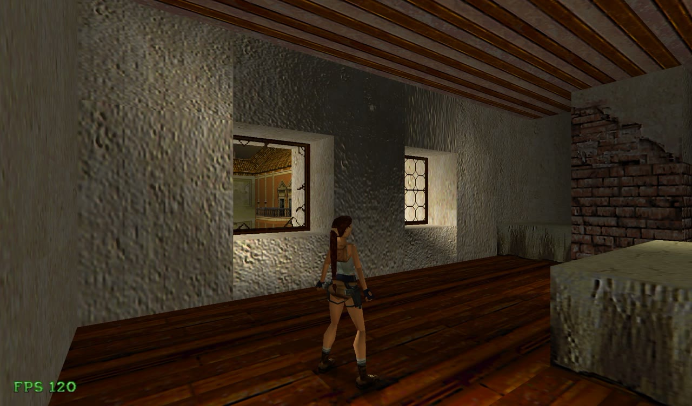
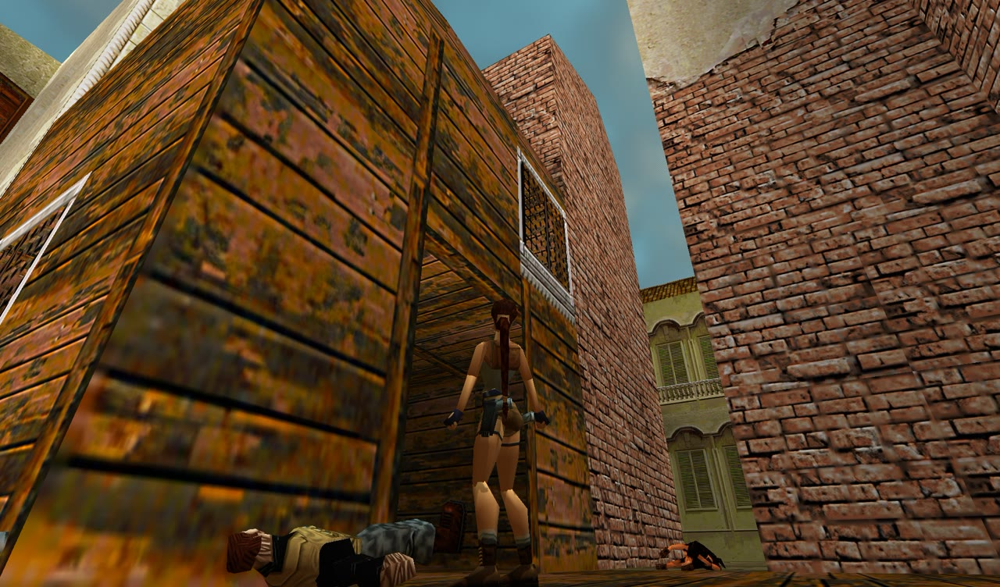
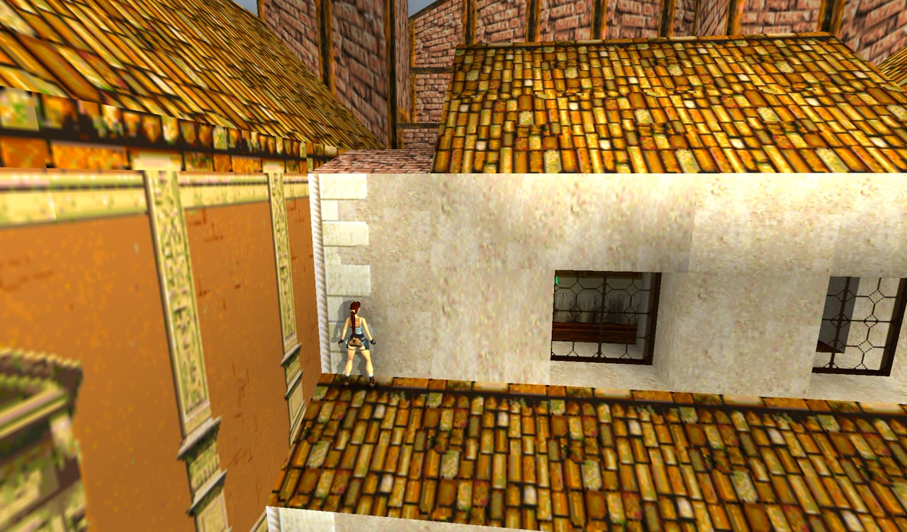

# OpenLara (johnhsb fork)

Classic Tomb Raider open-source engine — [XProger/OpenLara](https://github.com/XProger/OpenLara)의 포크입니다.
업스트림(`3b268ca`, 2026-07) 위에 **커밋 229개**를 더해, Tomb Raider II를 처음부터 끝까지 플레이할 수 있게 하고
원작과 다른 동작을 바로잡았으며, 그래픽 옵션과 데스크톱 빌드를 보강했습니다.

*A fork of XProger's OpenLara that makes Tomb Raider II playable from start to end, brings many behaviours back to
the original game, and adds texture packs, a sky, dynamic lights and 64-bit Windows / WSL builds.
The detailed change list below is in Korean.*

[](https://opensource.org/licenses/BSD-2-Clause)

- **다운로드**: [Releases](https://github.com/johnhsb/OpenLara/releases) (Windows x64, Linux x64)
- **변경 사항 전체**: [docs/CHANGES.md](docs/CHANGES.md)
- **TR2 이식 기록과 유의사항**: [docs/TR2_PLAN.md](docs/TR2_PLAN.md)

게임 데이터는 포함되어 있지 않습니다. 정식으로 구입한 Tomb Raider 1 / 2 PC판의 데이터가 필요합니다.

## 업스트림 대비 달라진 점

| 분야 | 요약 |
|---|---|
| **Tomb Raider II** | 적 30여 종, 탈것(스피드보트·스노모빌), 함정과 장치, 무기·조명탄·사다리·집라인, 보스(바르톨리와 드래곤), 엔딩까지 구현 |
| **원작 재현** | 점프 높이와 모서리 잡기 판정, 트리거 규칙, 적 AI·명중률, 카메라, 충돌 처리 등을 원작 동작에 맞춤 |
| **그래픽** | 업스케일 텍스처 팩, 노멀 맵, 원경 안개, 구름과 해가 있는 하늘, 불·폭발·조명탄의 동적 조명, 라라 얼굴 텍스처 |
| **편의 기능** | 상호작용 오브젝트 강조, FPS 표시(F), 스크린샷(F12), 게임별 세이브 폴더, 시작 위치 지정 실행 옵션 |
| **플랫폼** | 64비트 Windows(MSVC) 빌드, WSL GPU 렌더링, Linux 대소문자 무시 데이터 탐색, macOS 최신 Xcode 빌드 |
| **한국어** | TR2 컷신 한국어·영어 자막, 자막 싱크 편집기, 한글 글리프 생성기 |

## 스크린샷

| | |
|---|---|
|  텍스처 팩과 물 표현 (TR1) |  하늘과 원경 안개 (TR1) |
|  업스케일 텍스처와 노멀 맵 (TR1) |  폭포와 하늘 (TR1) |
|  물 커스틱 (TR1) |  강조 표시된 마이다스의 손 (TR1) |
|  스피드보트와 항적 (TR2) |  그림자와 FPS 표시 (TR2) |
|  베니스의 적 (TR2) |  바르톨리의 은신처 지붕 (TR2) |

## 실행

1. [Releases](https://github.com/johnhsb/OpenLara/releases)에서 받은 실행 파일을 게임 데이터 폴더에 둡니다.
   폴더에는 원본의 `data/`(TR2) 또는 `DATA/`(TR1), `audio/` 또는 `music/`, `fmv/`가 있어야 합니다.
2. 실행합니다. 레벨과 시작 조건을 지정할 수도 있습니다.

```
OpenLara.exe data/venice.tr2 --pos=73,37376,3840,18944,0 --give=KEY_ITEM_2
```

| 옵션 | 뜻 |
|---|---|
| 첫 인자 (Linux는 `-l`) | 시작할 레벨 파일 |
| `--pos=room,x,y,z,angle` | 라라의 시작 위치 (Windows, macOS) |
| `--give=item[,item...]` | 시작할 때 인벤토리에 넣을 아이템 |
| `--activate=index[,index...]` | 시작 1초 뒤 작동시킬 엔티티 |
| `-d dir`, `-f` (Linux) | 데이터 폴더, 전체 화면 |

세이브와 설정은 게임별 폴더에 저장됩니다 (Windows: `%APPDATA%\OpenLara\tr1`, `tr2`; Linux: `~/.openlara/tr1`, `tr2`).

### 텍스처 팩

데이터 폴더의 `texture/`에 `<LEVEL>_<tile>.png|jpg`를 두면 레벨의 타일을 대신합니다.
`src/platform/sdl2/texture_pack.sh`가 원본 타일을 내보내 Real-ESRGAN으로 업스케일합니다.
`texture/LARA_HEAD.png`는 라라의 얼굴 텍스처를 바꿉니다.

## 빌드

| 플랫폼 | 방법 |
|---|---|
| Windows x64 | `src\platform\win\build_msvc.bat` (Visual Studio) |
| Linux / WSL | `src/platform/sdl2/build.sh` (SDL2, GLES3) |
| macOS | `src/platform/osx/build.sh` (`-d`는 디버그) |

## 원본 프로젝트

OpenLara는 [XProger](https://github.com/XProger)가 만든 엔진입니다.
[WebGL 데모](http://xproger.info/projects/OpenLara/) ·
[업스트림 저장소](https://github.com/XProger/OpenLara) ·
[Discord](https://discord.gg/EF8JaQB) ·
[Tomb Raider Forums](http://www.tombraiderforums.com/showthread.php?t=216618)

원작 동작은 [TRX](https://github.com/LostArtefacts/TRX)를 참고로 확인했으며, 코드는 옮기지 않았습니다.
