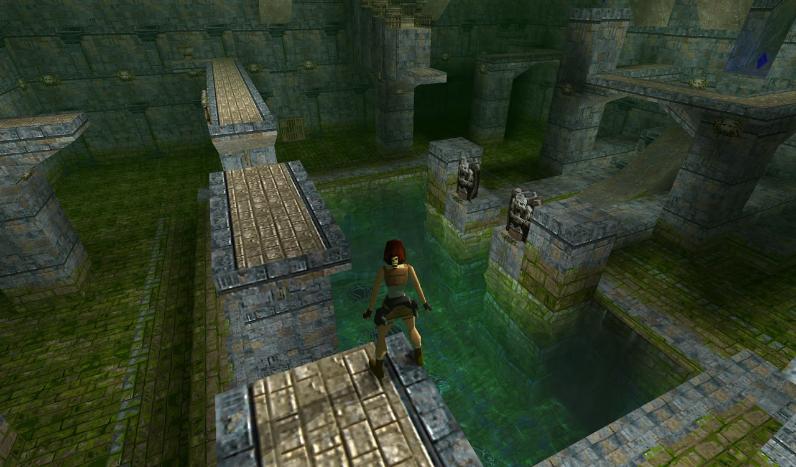
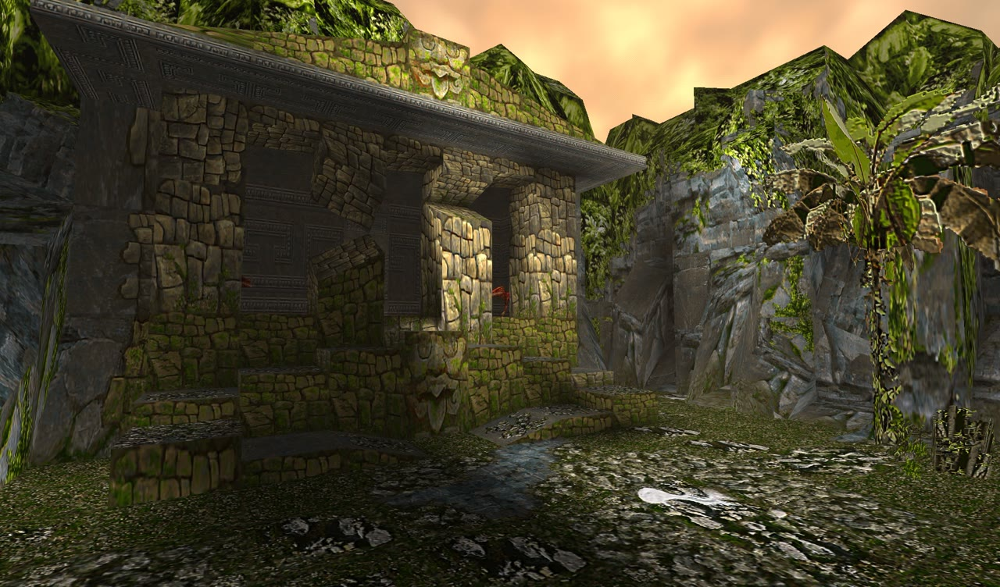
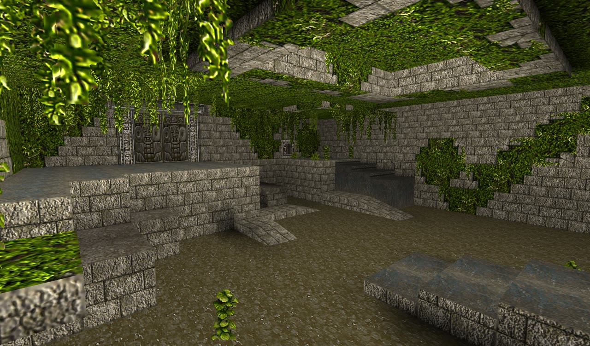
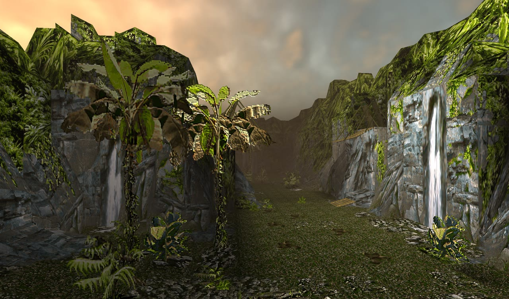
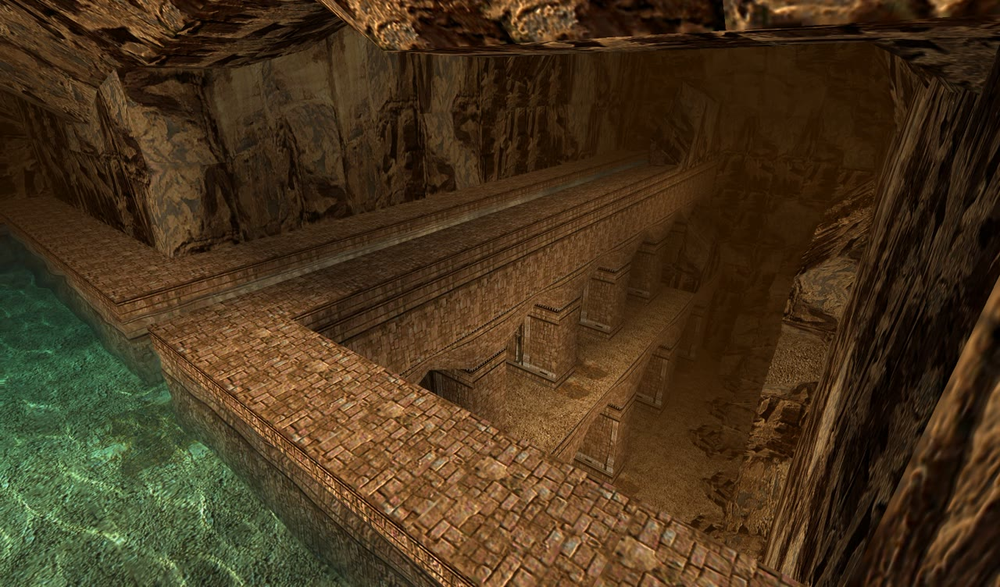
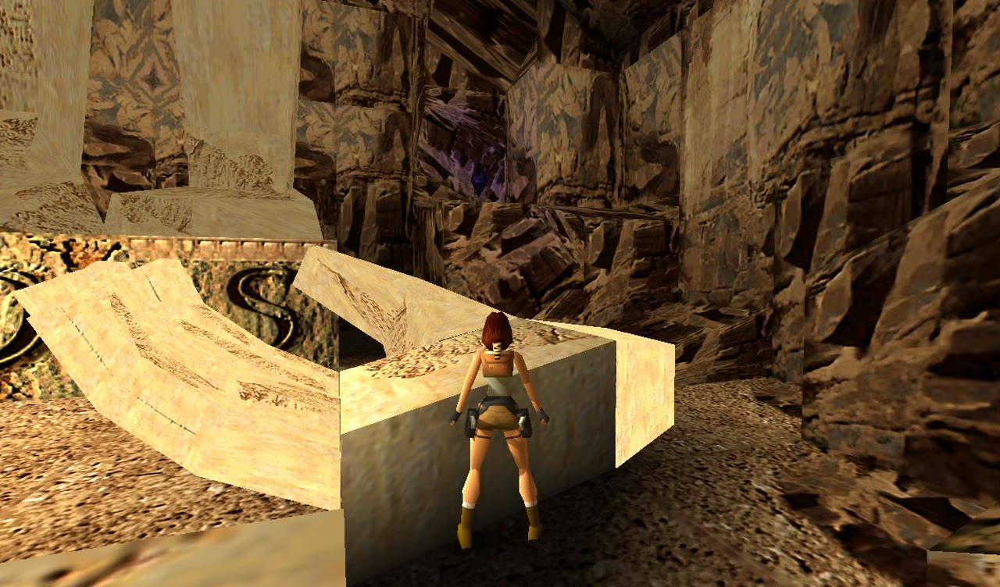
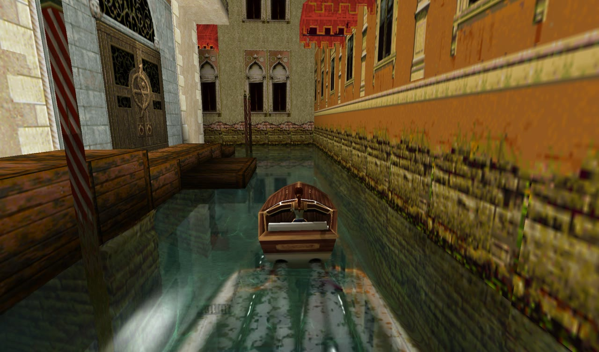
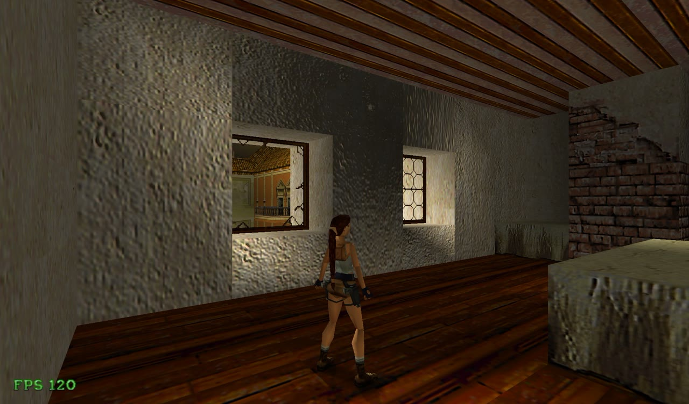
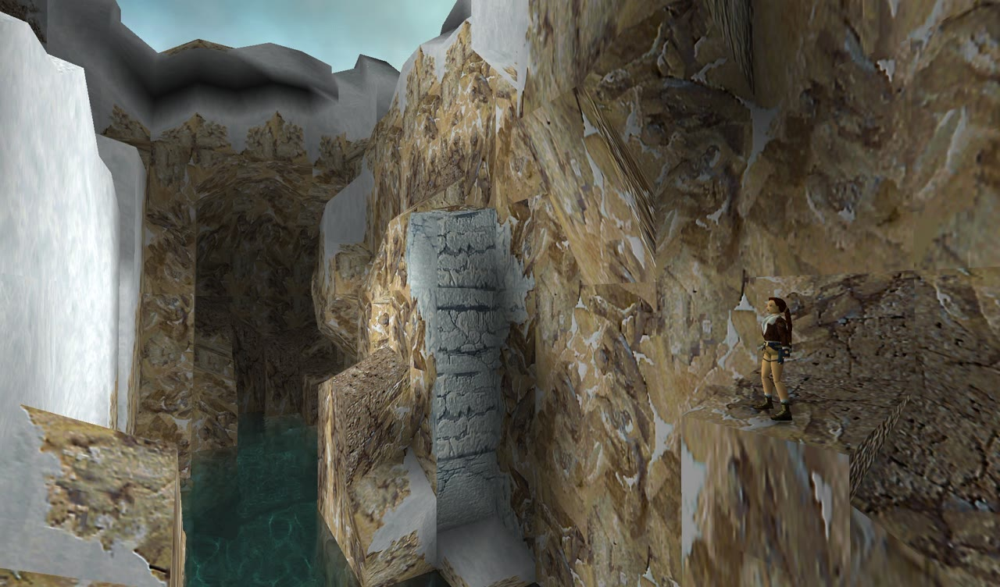
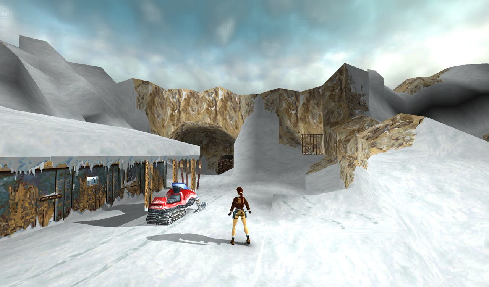

# OpenLara (johnhsb fork)

Classic Tomb Raider open-source engine — [XProger/OpenLara](https://github.com/XProger/OpenLara)의 포크입니다.
업스트림(`3b268ca`, 2026-07) 위에 **커밋 273개**를 더해, Tomb Raider II를 처음부터 끝까지 플레이할 수 있게 하고
원작과 다른 동작을 바로잡았으며, 그래픽 옵션과 데스크톱 빌드를 보강했습니다.

*A fork of XProger's OpenLara that makes Tomb Raider II playable from start to end, brings many behaviours back to
the original game, and adds texture packs, a sky, dynamic lights and 64-bit Windows / WSL builds.
The detailed change list below is in Korean.*

[](https://opensource.org/licenses/BSD-2-Clause)

- **다운로드**: [Releases](https://github.com/johnhsb/OpenLara/releases) (Windows x64, Linux x64·ARM64, macOS, 웹)
- **변경 사항 전체**: [docs/CHANGES.md](docs/CHANGES.md)
- **개발 지원 문서** (빌드, 테스트 위치, 크래시 분석, 시행착오): [docs/DEVELOPMENT.md](docs/DEVELOPMENT.md)
- **브랜치**: `main`은 TR1·TR2(버그 수정과 릴리즈), [`tr3`](https://github.com/johnhsb/OpenLara/tree/tr3)는 Tomb Raider III 구현 중

게임 데이터는 포함되어 있지 않습니다. 정식으로 구입한 Tomb Raider 1 / 2 PC판의 데이터가 필요합니다.

## 업스트림 대비 달라진 점

| 분야 | 요약 |
|---|---|
| **Tomb Raider II** | 적 30여 종, 탈것(스피드보트·스노모빌), 함정과 장치, 무기·조명탄·사다리·집라인, 보스(바르톨리와 드래곤), 엔딩까지 구현 |
| **원작 재현** | 점프 높이와 모서리 잡기 판정, 트리거 규칙, 적 AI·명중률, 카메라, 충돌 처리 등을 원작 동작에 맞춤 |
| **그래픽** | 업스케일 텍스처 팩, 노멀 맵, 원경 안개, 구름과 해가 있는 하늘, 불·폭발·조명탄의 동적 조명, 라라 얼굴 텍스처 |
| **편의 기능** | 상호작용 오브젝트 강조, FPS 표시(F), 스크린샷(F12), 게임별 세이브 폴더, 시작 위치 지정 실행 옵션 |
| **Tomb Raider III** | `tr3` 브랜치에서 구현 중 (아직 플레이 지원 안 함) |
| **플랫폼** | 64비트 Windows(MSVC) 빌드, WSL GPU 렌더링, Linux 대소문자 무시 데이터 탐색, macOS 최신 Xcode 빌드 |
| **한국어** | TR2 컷신 한국어·영어 자막, 자막 싱크 편집기, 한글 글리프 생성기 |

## 스크린샷

| | |
|---|---|
|  텍스처 팩과 물 표현 (TR1) |  하늘과 원경 안개 (TR1) |
|  업스케일 텍스처와 노멀 맵 (TR1) |  폭포와 하늘 (TR1) |
|  물 커스틱 (TR1) |  강조 표시된 마이다스의 손 (TR1) |
|  스피드보트와 항적 (TR2) |  그림자와 FPS 표시 (TR2) |
|  티베트 산기슭의 절벽 (TR2) |  티베트 산기슭의 스노모빌 (TR2) |

## 실행

1. [Releases](https://github.com/johnhsb/OpenLara/releases)에서 받은 실행 파일을 게임 데이터 폴더에 둡니다.
   폴더에는 원본의 `data/`(TR2) 또는 `DATA/`(TR1), `audio/` 또는 `music/`, `fmv/`가 있어야 합니다.
2. 실행합니다. 레벨과 시작 조건을 지정할 수도 있습니다.

```
OpenLara.exe data/venice.tr2 --pos=73,37376,3840,18944,0 --give=KEY_ITEM_2
```

| 옵션 | 뜻 |
|---|---|
| 첫 인자 (Linux는 `-l`) | 시작할 레벨 파일 |
| `--pos=room,x,y,z,angle` | 라라의 시작 위치 (Windows, macOS) |
| `--give=item[,item...]` | 시작할 때 인벤토리에 넣을 아이템 (Windows, macOS) |
| `--activate=index[,index...]` | 시작 1초 뒤 작동시킬 엔티티 |
| `-d dir`, `-f` (Linux) | 데이터 폴더, 전체 화면 |

`--give`는 세이브를 불러와도 적용됩니다. 레벨을 지정하지 않고 실행한 뒤 메뉴에서 세이브를 불러오면, 그 레벨에 아이템이 들어옵니다.
세이브에 열쇠나 퍼즐 아이템이 없어 진행이 막혔을 때 쓸 수 있습니다. 예를 들어 바르캉 수도원의 세라프는 `PUZZLE_4`입니다.

```
OpenLara.exe --give=PUZZLE_4
```

세이브와 설정, F12 스크린샷은 게임별 폴더에 저장됩니다 (Windows: `%APPDATA%\OpenLara\tr1`, `tr2`; Linux: `~/.openlara/tr1`, `tr2`;
macOS: `~/Library/Application Support/OpenLara/tr1`, `tr2`).

### Linux

Linux 묶음(x64, ARM64)은 glibc 2.34 이상인 배포판에서 실행됩니다(Ubuntu 22.04, Debian 12, Raspberry Pi OS 12, Fedora 35 이후).
필요한 라이브러리는 SDL2, EGL·GLES(그래픽 드라이버), ALSA, udev입니다. 묶음의 `install-deps.sh`가 빠진 라이브러리를 찾아
배포판의 패키지 관리자(apt, dnf, zypper, pacman)로 설치합니다. 설치 명령을 먼저 보여 주고 물어본 뒤 실행합니다.

```
./install-deps.sh           # 확인하고, 빠진 것이 있으면 설치 명령을 보여 주고 물어본 뒤 설치
./install-deps.sh --check   # 확인만 (0: 모두 있음, 1: 빠진 라이브러리 있음, 2: 이 시스템에서 실행할 수 없음)
./install-deps.sh --yes     # 묻지 않고 설치
```

glibc가 더 오래된 배포판이나 musl 배포판(Alpine)에서는 패키지로 해결되지 않으므로, `src/platform/sdl2/build.sh`로 직접 빌드합니다.

### 웹 버전

**바로 실행**: <https://johnhsb.github.io/OpenLara/> 를 열고 **Open Game Folder**로 PC판 Tomb Raider나 Tomb Raider II 폴더(`DATA`
폴더가 있는 곳, 두 게임이 든 상위 폴더도 됨)를 고르면 시작합니다. 게임 데이터는 사이트에 없습니다. 고른 폴더의 레벨과 음악은
브라우저 저장소(IndexedDB)에만 들어가고 어디로도 보내지 않으며, 다음 방문 때는 다시 고르지 않아도 됩니다.
**Forget Game Data**로 지웁니다.

**이 컴퓨터에서 서버로 실행**: 릴리즈의 웹 묶음(`OpenLara-…-web.zip`)을 풀고, 게임 폴더를 지정해 서버를 띄웁니다. Python 3이 필요합니다.
게임 폴더 없이 `python3 serve.py`로 띄운 뒤 페이지의 Open Game Folder를 써도 됩니다.

```
python3 serve.py --tr1 <Tomb Raider 1 폴더> --tr2 <Tomb Raider 2 폴더>
```

출력된 주소(`http://127.0.0.1:8000/`)를 브라우저로 엽니다. 게임 파일은 복사하지 않고 지정한 폴더에서 바로 읽으며,
서버는 이 컴퓨터에서만 접속할 수 있습니다. 한 게임만 지정해도 됩니다. 웹 버전에는 텍스처 팩이 적용되지 않습니다.

### 텍스처 팩

데이터 폴더의 `texture/`에 `<LEVEL>_<tile>.png|jpg`를 두면 레벨의 타일을 대신합니다.
`src/platform/sdl2/texture_pack.sh`가 원본 타일을 내보내 Real-ESRGAN으로 업스케일합니다.
`texture/LARA_HEAD.png`는 라라의 얼굴 텍스처를 바꿉니다.

## 빌드

| 플랫폼 | 방법 |
|---|---|
| Windows x64 | `src\platform\win\build_msvc.bat` (Visual Studio) |
| Linux / WSL | `src/platform/sdl2/build.sh` (SDL2, GLES3) |
| macOS | `src/platform/osx/build.sh` (`-d`는 디버그, `-u`는 인텔 겸용) |
| 웹 (WebAssembly) | `src/platform/web/build.sh` (Emscripten) |

릴리즈의 모든 묶음(Windows x64, Linux x64·ARM64, 웹, macOS)은 GitHub Actions(`.github/workflows/release.yml`)가 버전 태그를 올릴 때 빌드해 릴리즈에 추가합니다.

## 원본 프로젝트

OpenLara는 [XProger](https://github.com/XProger)가 만든 엔진입니다.
[WebGL 데모](http://xproger.info/projects/OpenLara/) ·
[업스트림 저장소](https://github.com/XProger/OpenLara) ·
[Discord](https://discord.gg/EF8JaQB) ·
[Tomb Raider Forums](http://www.tombraiderforums.com/showthread.php?t=216618)

원작 동작은 [TRX](https://github.com/LostArtefacts/TRX)를 참고로 확인했으며, 코드는 옮기지 않았습니다.
