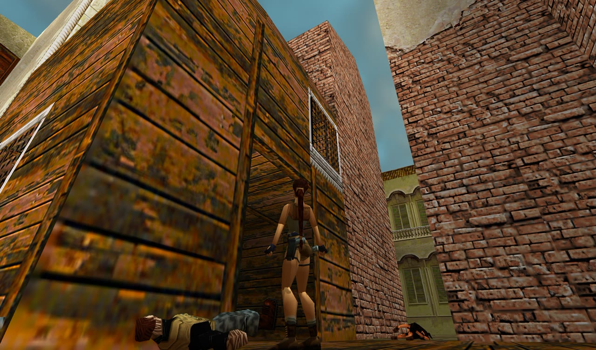
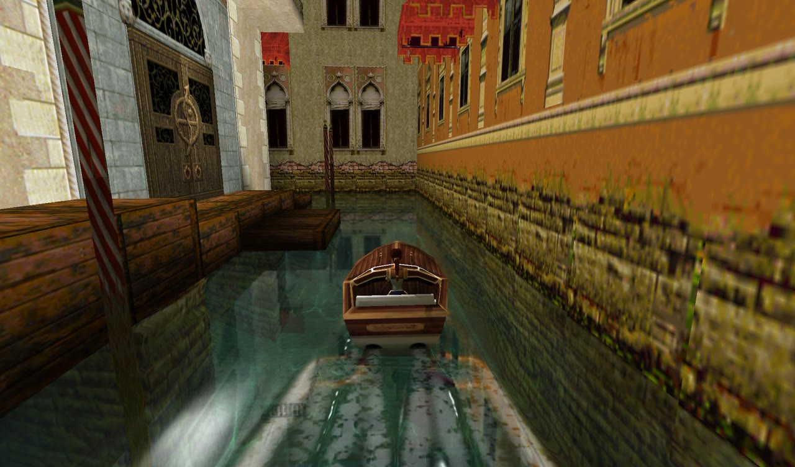
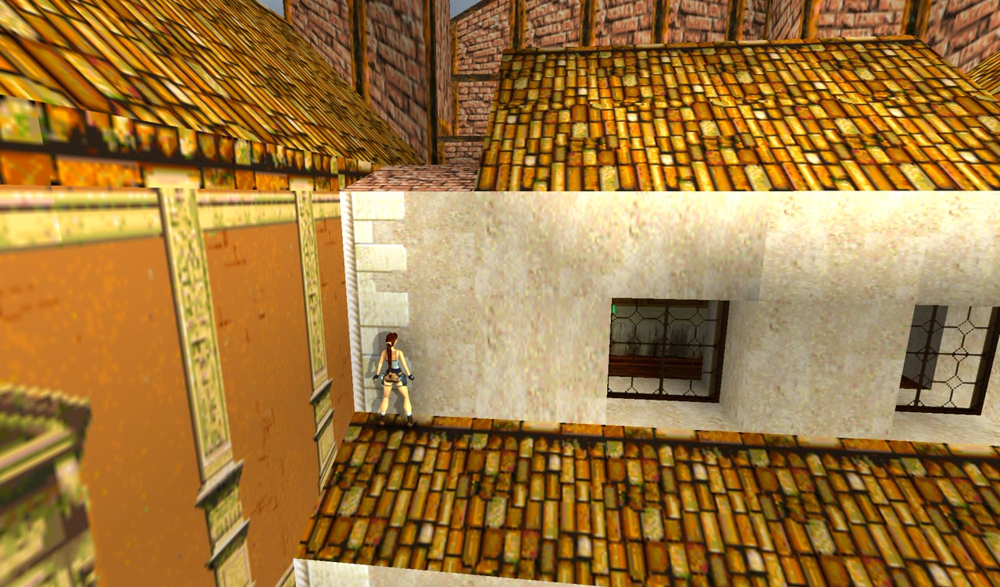
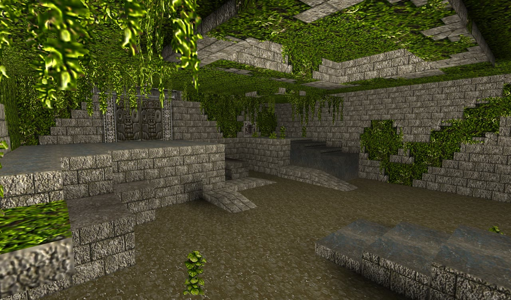
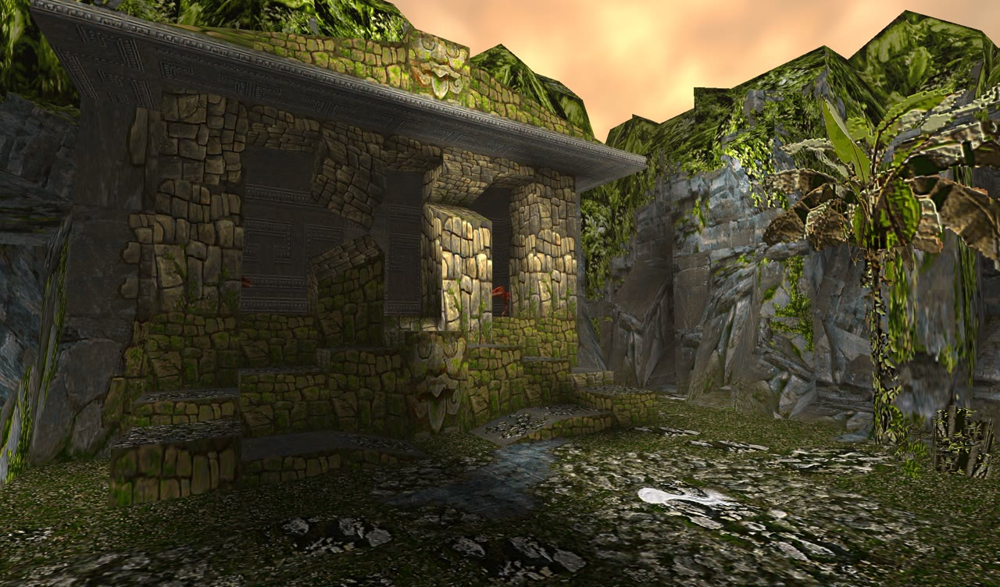
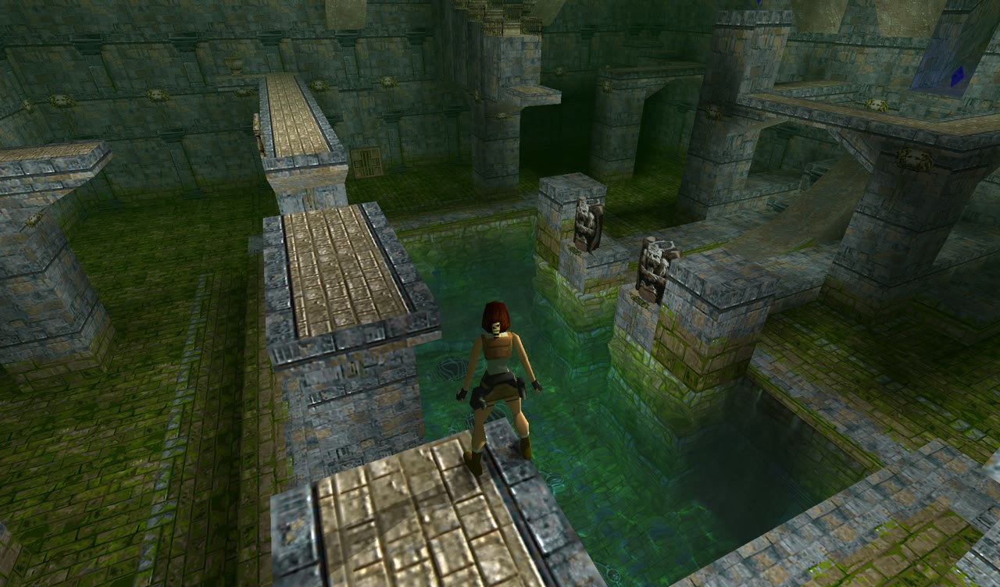
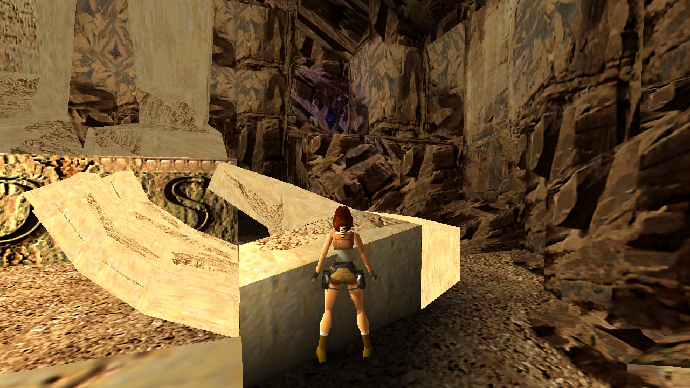
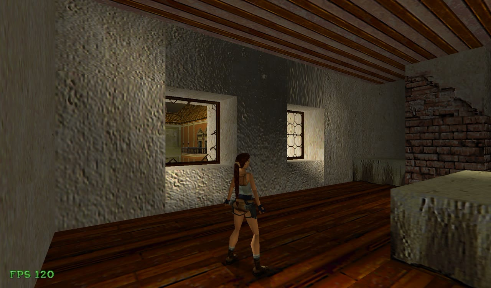

# 업스트림 대비 변경 사항

기준: [XProger/OpenLara](https://github.com/XProger/OpenLara) `3b268ca` (2026-07-26) → 이 포크의 `refactor/tr1-tr2-split`.
2026-10-11부터 2026-11-14까지 커밋 229개, 파일 69개에서 약 28,600줄 추가 / 4,000줄 삭제.

원작 동작이 기준입니다. 원작과 대조할 때는 원본 스크립트(`TOMBPC.DAT`)와 [TRX](https://github.com/LostArtefacts/TRX)의
동작을 참고했고, 코드는 옮기지 않았습니다. 구현 과정의 시행착오는 [TR2_PLAN.md](TR2_PLAN.md)에 있습니다.

## 1. Tomb Raider II

업스트림의 TR2는 레벨을 불러와 돌아다니는 수준이었고, 적은 대부분 제자리에 서 있었습니다.
이 포크는 첫 레벨부터 저택 엔딩까지 진행에 필요한 것을 구현했습니다.

### 라라
- TR2 무기(자동 권총, M16, 유탄 발사기, 작살총)와 조명탄, 떨어진 조명탄 줍기
- 사다리(등반 가능한 벽): 오르내리기, 옆으로 이동, 매달려 건너기, 옆 바닥으로 내려서기
- 집라인, 에어록 휠을 돌리는 전용 동작, 기폭 장치 누르기
- 얕은 물과 이웃한 방의 아이템 줍기, 퀘스트 아이템 줍기

### 탈것
- 스피드보트: 물리, 엔진 소리, 선착장에서 올라타기, 물보라와 항적, 곤돌라 충돌, 베니스 운하의 기뢰 폭발
- 스노모빌: 탈 수 있는 것과 무장 용병이 모는 것 (보트와 탈것 물리를 공유)

*베니스 운하의 스피드보트. 항적과 거품은 물 시뮬레이션에 들어갑니다.*

### 적
- 베니스·오페라: 복면 깡패, 곤봉 깡패, 산탄총 깡패, 개, 쥐
- 해상 플랫폼·난파선: 총잡이, 화염방사병, 잠수부와 작살, 상어, 바라쿠다, 곰치
- 티베트: 용병 3종, 예티, 탈리온의 수호자, 수도승, 독수리
- 중국: 석상 전사(창·검), 큰 거미와 작은 거미, 단검 투척병, 호랑이, 바르톨리와 드래곤
- 원작의 추격·도주 판단, 명중률, 공격 범위, 매복 숨김, 적끼리 싸울 대상 선택
- 죽은 적이 들고 있던 아이템을 떨어뜨림

### 함정과 장치
- 회전 칼날, 벽 칼날, 가시 벽, 가시 천장, 고드름, 전기톱과 갈고리, 구르는 공·드럼통
- 깨지는 창문, 스프링보드, 종과 징, 큰 그릇, 경보와 경광등, 프로펠러와 환풍기
- 오페라 하우스: 무너지는 무대 바닥, 흔들리는 모래주머니, 엘리베이터
- 드래곤 레어의 지진, 다이빙 구역의 헬리콥터와 죽어가는 수도승

### 진행
- 비밀 3개를 모으면 레벨 보상 지급, 비밀 발견 음악, 레벨 통계와 원본 스크립트의 레벨 이름
- 레벨 시작 연출(감방에서 일어나는 해상 플랫폼, 저택 등), 저택 엔딩
- PC판 음악 팩 폴더(`music/TrackNN.ogg`) 재생, 새·물방울·시계 종소리 등 환경음
- TR2 안티 트리거, HEAVY 트리거, 전투 트리거(총을 꺼냈을 때) 처리

## 2. 원작 재현 (TR1·TR2 공통)

*바르톨리의 은신처 지붕. 폭파 전에는 점프로 모서리에 손이 닿지 않아야 원작과 같습니다.*

### 점프와 매달리기
- **점프 높이**: 원작은 한 프레임(1/30초)의 중력을 먼저 더하고 이동합니다. 높은 프레임레이트에서 점프가
  약 4% 더 높이 올라가 원작에서 닿지 않는 모서리에 닿던 것을, 어떤 프레임레이트에서도 원작과 같은 궤적이 되게 했습니다.
- **모서리 잡기**: 손이 모서리를 지나는 프레임에만 잡힙니다. 모서리보다 아래에서 끌어올려지던 판정을 없앴습니다.
- **도약**: 도약 동작이 발판 끝을 지나도 점프 명령이 실행될 때까지 높이를 유지합니다.
- 천장에 닿은 점프는 천천히 떨어지기 시작하고, 공중에서도 몸 가운데 높이로 방을 판정합니다.
- 겹친 방과 가파른 경사의 모서리, 낮은 천장 아래와 방 경계의 모서리에서 매달리고 오르기

### 충돌과 이동
- 벽·계단·낮은 천장으로 밀려 들어간 이동을 되돌림, 크기 없는 충돌 상자의 정적 메시 통과
- 적을 통과해 걷지 못함, 죽은 T-Rex가 길을 막음, 닫힌 문 너머의 적이 닿지 못함
- 수면 가까운 바닥에서 멈추기, 물 밖 모서리로 올라서기, 물살이 겹친 박스를 지나 라라를 운반
- 함정은 라라가 실제로 범위 안에 있을 때만 피해를 줌

### 트리거와 적
- 무거운 물체만 HEAVY 트리거를 작동, 일회성 안티 트리거는 아이템을 영구히 끔
- 플립 효과는 플립과 함께만 실행, 플립 효과의 반복음 정지와 빠져 있던 효과 추가
- 원작의 조준 시야선, 가슴이 가려진 적의 머리 조준, 좁은 통로 모서리에서 서성이는 적 수정
- 트리거 카메라가 원작처럼 시점을 유지, 시네마틱 뒤 시야각 복원

## 3. 그래픽

- **텍스처 팩**: `texture/<LEVEL>_<tile>.png|jpg`가 레벨 타일을 대신합니다. 원본을 부드럽게 확대한 것에
  팩의 세부만 더해 경계와 색이 원본과 맞고, 투명 부분은 원본 모양을 유지합니다. 모든 코어로 불러옵니다.
- **노멀 맵**: 텍스처의 명암에서 만들어 방 표면에 입체감을 줍니다.
- **원경 안개**: 3블록 밖에서 시작해 부드럽게 짙어지고, 하늘이 지평선에서 안개로 이어집니다. 범위와 색은 옵션에서 정합니다.
- **하늘**: TR2 야외 레벨에 구름과 해. 옵션에서 켜고 끕니다.
- **동적 조명**: 불, 폭발, 조명탄이 주변과 이웃 방을 밝힙니다.
- **라라 얼굴**: `texture/LARA_HEAD.png`로 평상시와 화난 표정의 얼굴 텍스처를 바꿉니다.
- 애니메이션 텍스처의 프레임 블렌딩, 컷아웃 텍스처의 외곽선 보정, 물 시뮬레이션에 보트 항적과 거품

## 4. 편의 기능

- **상호작용 오브젝트 강조**: 스위치, 열쇠 구멍, 퍼즐 구멍, 기폭 장치, 마이다스의 손이 은은하게 밝아져 벽과 구분됩니다.
  방의 조명보다 어두워지지는 않으며, 사용한 열쇠 구멍은 강조가 꺼집니다.
- **F**: FPS 표시, **F12**: 스크린샷 저장
- TR1과 TR2의 세이브·설정을 게임별 폴더에 분리 저장 (기존 파일은 처음 한 번 복사)
- 실행 옵션으로 레벨, 시작 위치, 인벤토리 아이템, 작동시킬 엔티티 지정

## 5. 플랫폼과 빌드

- **Windows**: Visual Studio 64비트 빌드 스크립트, 로컬 인증서 서명, 로그 파일과 크래시 추적
- **Linux / WSL**: GLES3 SDL2 빌드, WSL에서 GPU(D3D12) 렌더링, 파일 이름 대소문자와 무관한 데이터 탐색,
  오디오 장치를 열 수 없을 때 소리가 쌓이지 않음
- **macOS**: Xcode 27 빌드 수정, 명령줄에서 레벨과 시작 위치 지정
- 설정에서 읽은 품질 값을 하드웨어가 지원하는 범위로 제한

## 6. 한국어

- TR2 컷신 1~3의 한국어·영어 자막과 음성 싱크
- 자막 싱크 편집기(`src/tools/subtitles`), macOS·Linux에서 도는 한글 글리프 생성기(`src/tools/glyphs`)

## 7. 코드 구조

- TR1과 TR2의 적·오브젝트를 전용 헤더로 분리: `enemy_tr1.h`, `enemy_tr2.h`, `objects_tr1.h`, `objects_tr2.h`.
  공용 코드는 `enemy.h`, `objects.h`에 남깁니다.
- 탈것 물리는 `Vehicle`로 묶어 보트와 스노모빌이 공유합니다.

## 알려진 차이

- Tomb Raider III 이후는 업스트림 그대로이며 손대지 않았습니다.
- 원작과 다르게 남겨 둔 작은 차이와 플레이로 확인하지 못한 항목은 [TR2_PLAN.md](TR2_PLAN.md) 6장에 있습니다.
